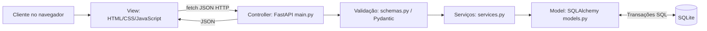
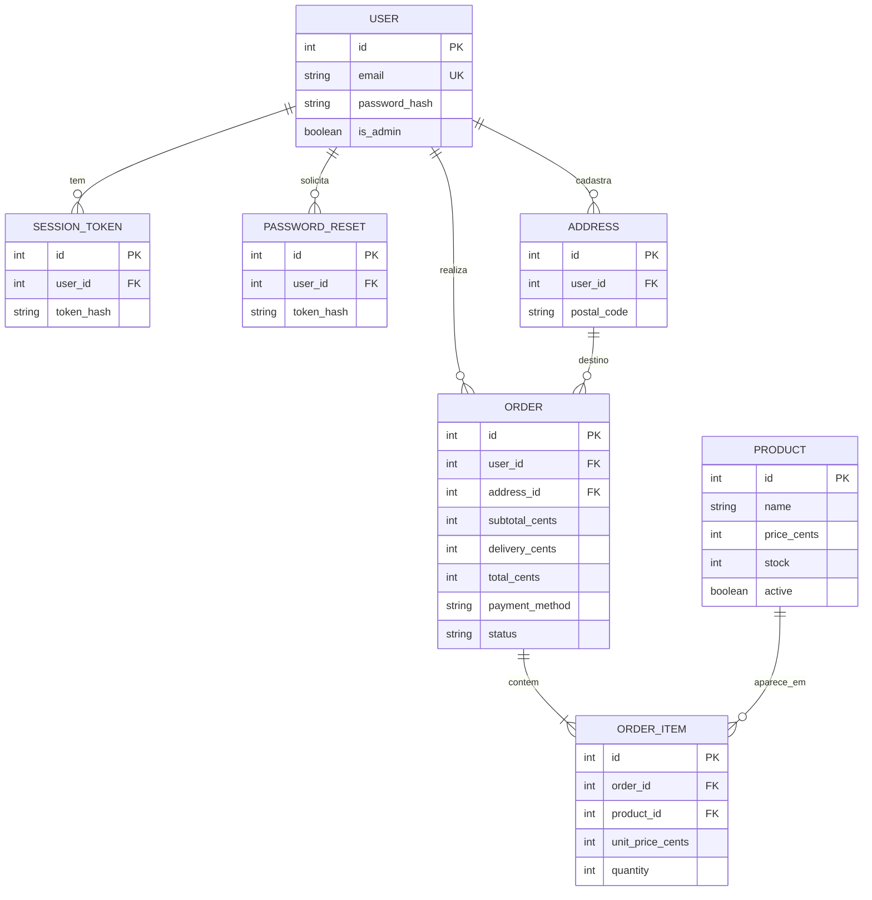
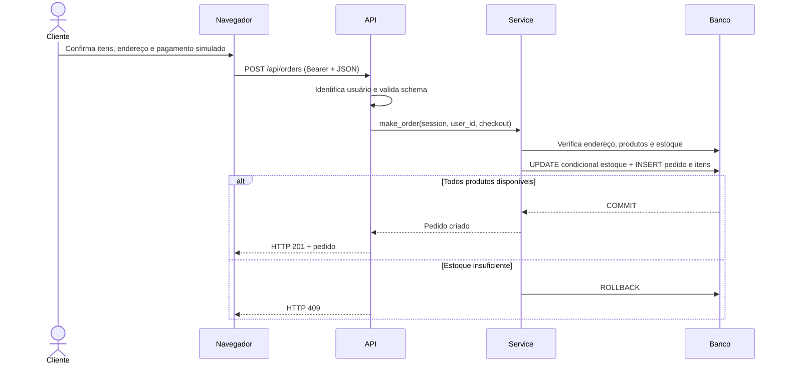

# Arquitetura MVC, serviços e dados

## Visão de alto nível

**View (apresentação):** `app/static/index.html`, `styles.css`, `app.js`. Mostra o catálogo, recebe dados e exibe mensagens. **Controller (controle):** `app/main.py`. Faz roteamento HTTP, autenticação, autorização e transforma respostas. **Model (domínio e dados):** `app/models.py`, `app/database.py`, regras em `app/services.py`. **DTO/validação:** `app/schemas.py`. É uma adaptação MVC para API JSON e cliente web SPA sem dependência de framework JavaScript.

## Banco de dados — modelo lógico

`FEEDBACK` é tabela independente com `tester_name`, `feature`, `worked`, `description` e data. Entidades são criadas automaticamente via `Base.metadata.create_all(engine)` e seeding separado. Chaves estrangeiras referenciam os IDs, índices de email/token e regras de validação são aplicadas pelo servidor. **Atenção:** SQLite não habilita enforcement de FKs por padrão nesta versão; referências sensíveis são validadas também nas rotas/serviços.

## Exemplo de sequência de pedido

## Contratos, integridade e fronteiras

- O cliente envia IDs e quantidades, **não** informa preço. O servidor consulta preços oficiais e calcula totais.
- Senhas ficam em hash com salt aleatório; tokens opacos são armazenados apenas como hash SHA-256 no banco. Tokens no navegador usam `sessionStorage`, limpos no logout.
- Erros de domínio são mapeados para `400/404/409`, falhas de validação para `422`, autenticação para `401`, autorização para `403`.
- Pedido/estoque usa uma transação com atualização condicional. SQLite é adequado à prova de conceito local; para operação real com muitos pedidos simultâneos, banco transacional gerenciado e teste de concorrência.
- Não há integração com provedor de cobrança e a cobrança nunca é informada como concluída.

## Dicionário resumido

| Tabela | Campo | Tipo | Regra |
|---|---|---|---|
| `users` | `email` | VARCHAR(160) | Único, obrigatório |
| `users` | `password_hash` | VARCHAR(250) | Hash PBKDF2, obrigatório |
| `products` | `price_cents` | INTEGER | Valor positivo pela API |
| `products` | `stock` | INTEGER | >= 0 pela API e reserva condicional |
| `addresses` | `postal_code` | VARCHAR(8) | Exatamente oito dígitos |
| `orders` | `status` | VARCHAR(30) | Estados previstos no controller |
| `orders` | `total_cents` | INTEGER | Subtotal + frete, calculado no servidor |
| `order_items` | `unit_price_cents` | INTEGER | Snapshot na data do pedido |
| `sessions` | `token_hash` | VARCHAR(64) | SHA-256, único |
| `feedbacks` | `worked` | BOOLEAN | Resultado informado pelo avaliador |
